# Comment 1 of 3 — The journey this PoC implements

> **Draft, not posted.** Images are inline and live in `__tmp__/shots/`. When this goes to GitHub the
> relative paths need replacing with uploaded attachments.
>
> **Audience:** anyone, including people who have never opened Agent Chat. No framework vocabulary.
> Attachments, versions, refs and `format()` belong in comment 2.

---

Here is the user journey and what it is like to use. Further comments will cover how it is built and what had to be worked around to build it.

A user opens Agent Chat and asks what is noisy in their logs. The agent runs a query and renders a
table of log patterns ranked by count, each with a trend sparkline. From there the user works the
table directly: mute a pattern they already understand, move the time window, take one pattern and
compare it against an earlier period. When they ask the agent something, the answer is about the
table as it stands now rather than the one the agent rendered three turns ago.

A major goal of the journey is to explore a new interaction model within Agent
Chat. Narrowing the view is free. A mute is a click, not a reasoning turn. That
was spiked separately in #6064 before this PoC started, because if the most
common action in the product is also its slowest then the loop is not worth
building.

## The journey in one pass

### 1. Ask

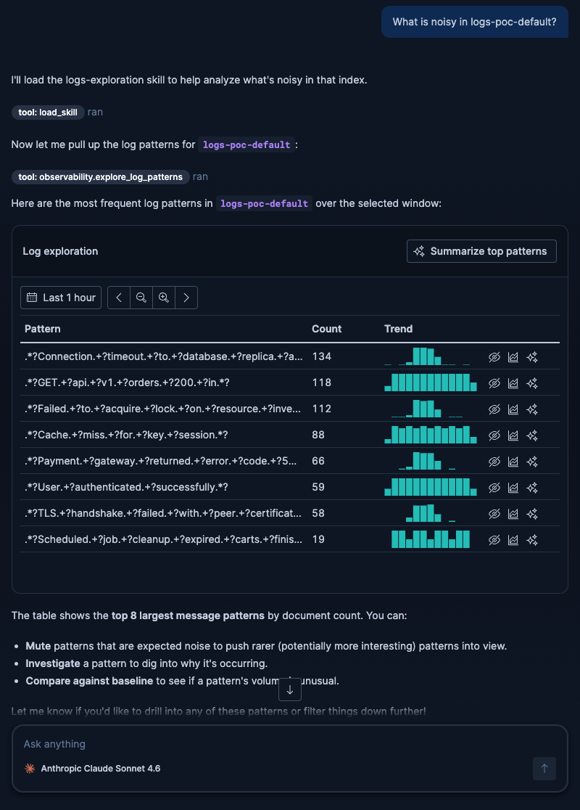

"What is noisy in my logs?" The agent chooses the pattern table without being told which view to use,
categorises the log messages over the window, and renders the top 8 by count with a sparkline on each
row. That is Renderer A.

The data never passes through the model. The tool runs the query and builds the view server-side, and
the model receives only an id to place in its reply. Routing a table this dense through the model
would be slow, lossy and unbounded. We have a trace of that happening to a much smaller payload, and
it cost several model calls and a very large input purely to retype rows the tool had already
computed.

### 2. Mute what you already understand

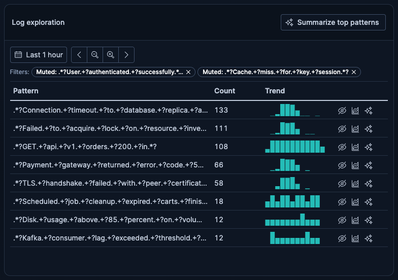

Every row has a mute button. The row leaves the view at once. The table is a top-8 cut, so the query
then re-runs without that pattern and the ninth-ranked one moves up into the space. Muting "User
authenticated successfully", the kind of noise a user already understands, pulled "Kafka consumer lag
exceeded threshold" up into the cut, and the table stayed full.

Each mute leaves a chip above the table with a remove cross, so the narrowing is visible and
reversible, and it survives a page reload.

### 3. Move the window

Both views carry a window picker with shift and zoom. Before, at the default window:

After a single click on zoom out:

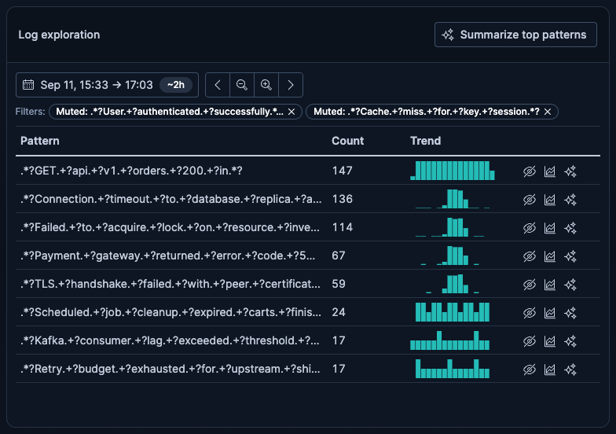

The table re-ranks underneath you. That one click changed which pattern is top, as the orders
endpoint overtook the database-timeout pattern, and it changed the bottom of the cut too, dropping a
disk-usage pattern and pulling in a retry-budget one. No model turn.

On the comparison view the baseline period moves with the window, so the two periods stay the same
length and the same distance apart through every shift and zoom.

### 4. Take one pattern and compare it against a baseline

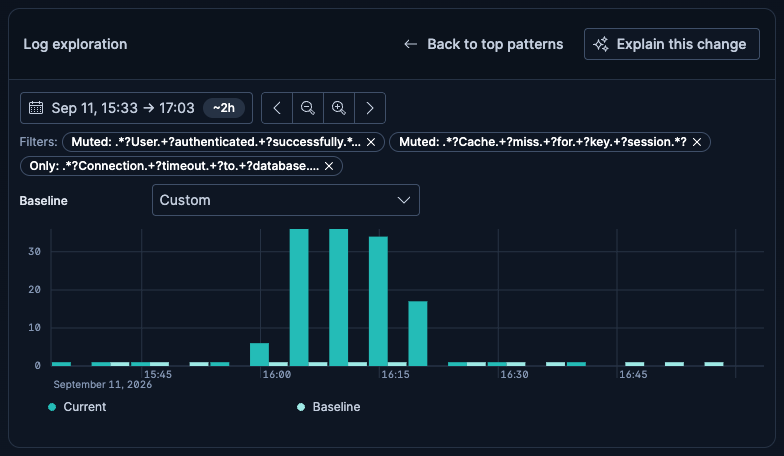

A row action scopes the journey to that single pattern and asks the agent to compare it against an
earlier period. The agent picks the comparison view and queries it. That is Renderer B, drawn as two
bar series clustered per bucket rather than overlaid as the criteria describe: overlaying two bar
series turns out to be impossible in the charting library, and the next comment has the detail.

The baseline defaults to the period immediately before the window. The picker beside the chart also
offers an hour, six hours, a day or a week earlier, or a range chosen by hand, and changing it
re-queries the baseline series without a model turn.

This one costs a turn, and the order matters. The scope is saved first, then the agent is asked, so
it answers about a view that already exists rather than rebuilding one. The
message it receives carries no pattern text at all; the agent reads the view to find out what it has
been scoped to. The result lines up with where the user came from, because the comparison's
current-period total is exactly the count that was shown on the row they clicked.

### 5. Come back to the table

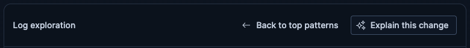

One click in the header drops the scope and returns to the pattern table, keeping the window and any
mutes. The chip goes, the table comes back with a fresh query, the window is preserved, and the
header's main action returns to "Summarize top patterns".

The agent called the pattern tool with no parameters at all. Nothing about the user's accumulated
state had to be reconstructed from the conversation, which is the thing that tends to go wrong.

### 6. Ask a follow-up

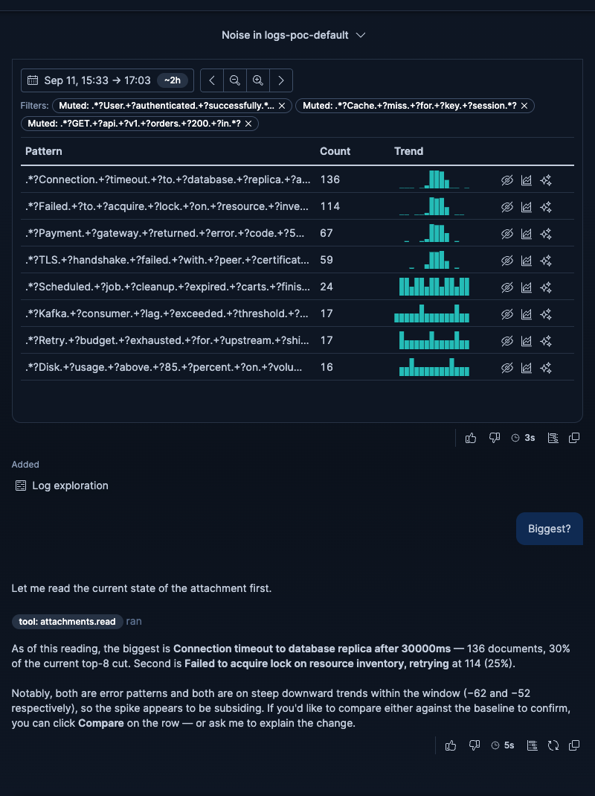

Short questions, of the kind people actually type. "Biggest?" Asked straight after muting the pattern
that had been at the top, the answer named the new top pattern and gave its share of the current cut.
It did not repeat the row it had shown a moment earlier.

Asked outright what window and filters were in effect, the agent answered with the window and the
muted patterns as of that reading, and pointed out that the picker had moved since the question
was typed.

Keeping this reliable was the hardest part of the PoC and it is not fully closed. The agent can still
answer from stale conversation text instead of from the current view. It happens much less often than
it did, the mechanism is understood, and the rate is not established.

### 7. Ask for an interpretation

Each view has one main action in its header. On the table it is "Summarize top patterns". On the
comparison it is "Explain this change".

The table's action started life as "Summarize remaining patterns", meaning list them with their
counts. That is the wrong job for the agent, because the user can already read the rows. It became
interpretation instead: which pattern dominates, what is rising, what is worth muting or investigating
next, with percentages scoped to the visible cut rather than to the whole index. Run on the cut above,
it opened by naming what it was computed from, gave the leading patterns as a share of that cut, and
grouped the ones it thought shared a cause.

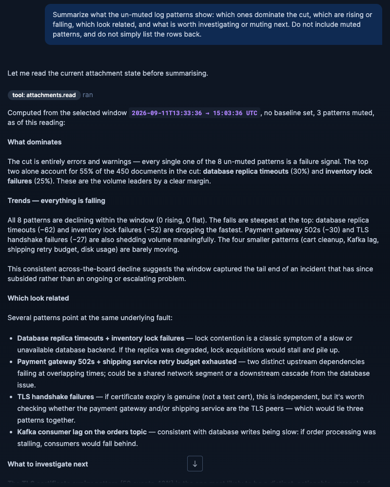

It closed by recommending a mute. Because that is something the table can do, it then re-rendered the
live table underneath the recommendation, so the user can act on it without typing anything.

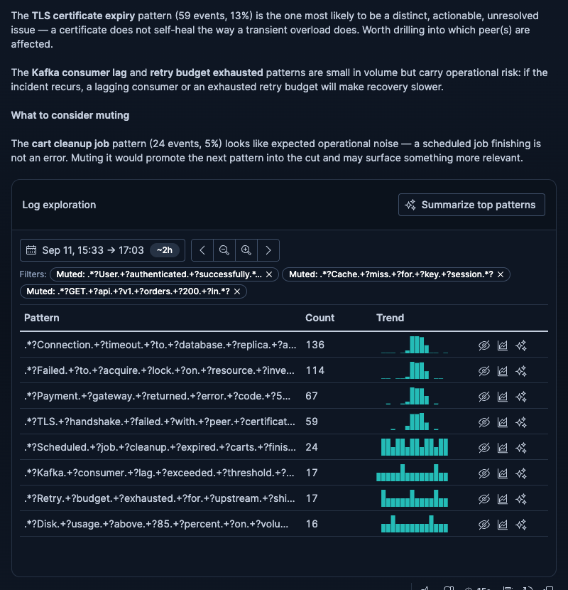

"Explain this change" names the total for each period and the size of the rise between them, points
at the busiest bucket in each and the bucket that moved most, and draws a conclusion about whether
this looks like an incident starting or a gradual drift. It quotes no raw bucket values.

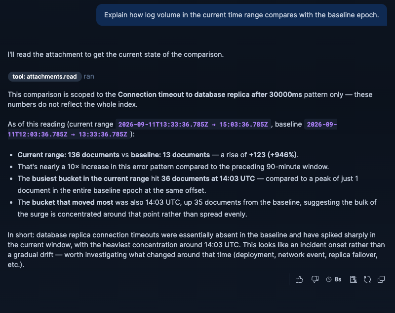

## Two kinds of button

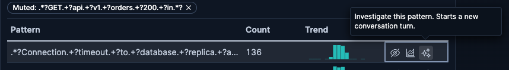

Buttons that change the view are plain. Buttons that start an agent turn carry a sparkle icon and a
tooltip that says so. A row carries three: mute, compare against a baseline, and Investigate. That
last one asks the agent why a single pattern is occurring, and it answers against the window and the
mutes in effect at the moment it is clicked rather than the ones in force when the table was drawn.

Header actions are the exception on both counts. They cannot carry a tooltip, and at narrow widths
they collapse to bare icons, where two sparkles side by side would be indistinguishable. The reason
is a framework limitation, covered in the next comment.

## What the agent sees while the user does this

Every time the agent answers, it re-reads the view as it currently stands: the window, the mutes, the
scope, the rows and their counts. It is also told when those numbers were fetched, so it can check
whether a reading has gone stale rather than simply being warned that it might be.

There is a limit worth stating here rather than burying it. Earlier rounds stay in the conversation,
so the agent's own previous readings sit in its context going out of date while the user keeps
clicking. That is the source of the stale answers in step 6, and the next comment covers why it is
hard to fix from our side.

## The loop

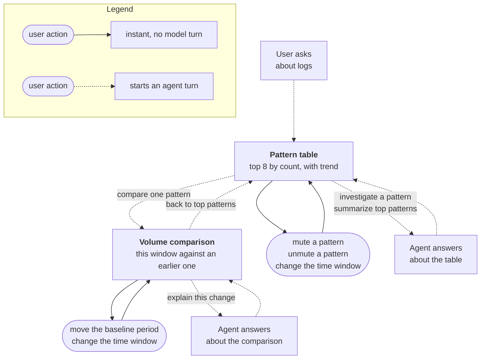

## One mute, end to end

The point of this one is what is missing from it.

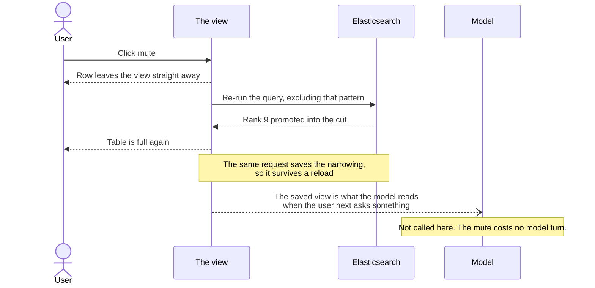

## What the journey does not do yet

Two views and five interactions were the scoped slice, and the slice grew a little during the PoC.
What is not here:

- Drilling from a pattern into the sample log lines behind it.
- A pattern-by-time heatmap, showing which patterns fire when.
- A list of significant field values, meaning fields that are newly present or have shifted rate.
- Focusing the window onto a spike by selecting it on the chart, and filtering the table by log
  level. Both are designed and queued rather than built.

The third comment covers what the built operations suggest about the cost of the ones that were not.

---

# Working notes below this line. Not part of the comment.

## Screenshot provenance

All captured in one browser session, one conversation, against a freshly seeded index, on 2026-09-11.
Dark theme, sidebar collapsed, attachment at full width so the header shows labels rather than
collapsing to icons. The comment itself says only that they come from one session, which is as much
as a reader needs.

One further shot exists and is not used: `09-superseded-render.png`, an earlier round whose view has
been superseded, showing the badge, the greyed-out window controls, chips with no remove cross and
only the agent-turn action left on each row. It illustrates a framework behaviour rather than the
journey, so it belongs in the second comment.

The Summarize answer is taller than the screen, so it is two images rather than one. Capturing it as
a single element shot produced a broken frame: the conversation's own fixed message box painted over
the live table at the bottom, which is the part worth seeing.

## Notes on this draft

- **Steps 4 and 5 cost an agent turn**, and the draft says so rather than filing them under instant.
  The honest version of the claim is that the cheap actions are cheap and the ones needing reasoning
  are not, which is a better story than an overclaim that the first reader would catch.
- **The diagrams use solid against dotted lines rather than colour**, so they survive GitHub's dark
  theme. Neither has been rendered anywhere yet. The legend is a subgraph rather than a floating
  node; if it lands in an awkward place, the fallback is deleting it and putting the distinction in a
  sentence underneath.
- **Step 6 carries the stale-answer caveat** because it is a property of the journey and not only of
  the implementation. Moving it wholly into comment 3 would make this comment read better and less
  true.
- **All measured quantities have been removed from the prose**, on request. Counts, durations,
  percentages, token figures, the baseline offset and the stale-answer rates are gone; the behaviour
  each was evidence for is stated instead, and the screenshots carry the actual numbers. Comments 2
  and 3 are where the measurements live.
- **Two numbers deliberately survive**, because they describe the shape of the feature rather than an
  observation: the table being a top-8 cut, and there being two views. Both are visible in every
  screenshot, so removing them would leave the prose vaguer than the images beside it.
- **The claim about routing the payload through the model** in step 1 no longer cites a figure. The
  trace behind it came from a service topology attachment rather than from logs, so losing the number
  also loses an inherited caveat.

## Review against the issue, 2026-09-11

Checked with a reader in mind who has just read the acceptance criteria and scrolled down. The issue
has no other comments, so this is the first thing they hit.

Changed as a result:

- Added an opening that says what the three comments are. Without it the reader lands mid-walkthrough
  with no idea where the verdict lives.
- Anchored both views to the criteria's names, "Renderer A" and "Renderer B", once each. The draft
  called them the pattern table and the volume comparison throughout, leaving the reader to translate
  while ticking off a checklist.
- **Flagged the deviation from "Baseline-overlaid histogram".** The criterion says overlaid; the
  build clusters the bars. The draft said "clustered bar series" and left it, which either reads as a
  silent miss or gets spotted as one. It now names the difference and the reason.
- Added the baseline picker to step 4. "Baseline epoch picker" is its own criterion and the draft
  only said the baseline moves with the window, which is a different claim. The control is visible in
  the shot but was not described.
- Added what Investigate does. It is a named criterion and the draft mentioned the button twice
  without ever saying what it is for.
- Replaced "comment 2" and "comment 3" with "the next comment" and "the third comment". Nothing links
  until they are posted, and a numbered reference to a comment that does not exist reads as broken.

Left alone, and worth a decision:

- **Length.** Ten images and about 2,200 words. GitHub will fold it behind "show more". Dropping
  `03a` (only useful beside `03b`) and `07b` would cut two images without losing a step.
- **The title says "sifting", this says exploration.** The PoC renamed it deliberately. A reader may
  wonder whether this is the same effort. One clause would close it, or retitle the issue.
- **"The cut"** carries a lot of weight and is PoC jargon. It is introduced in step 2 and used about
  ten times after. A reader who skims may never pick it up.
- **No verdict here, by design.** A reader arriving at the first comment on an issue whose final
  criterion is "a written verdict" may expect one. The new opening points forward instead.
