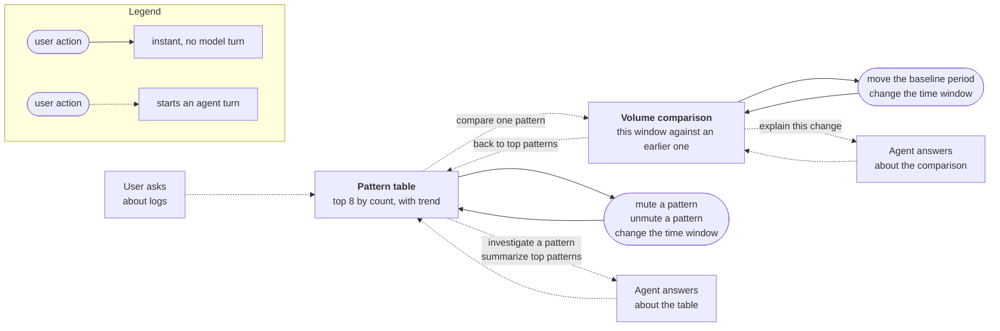
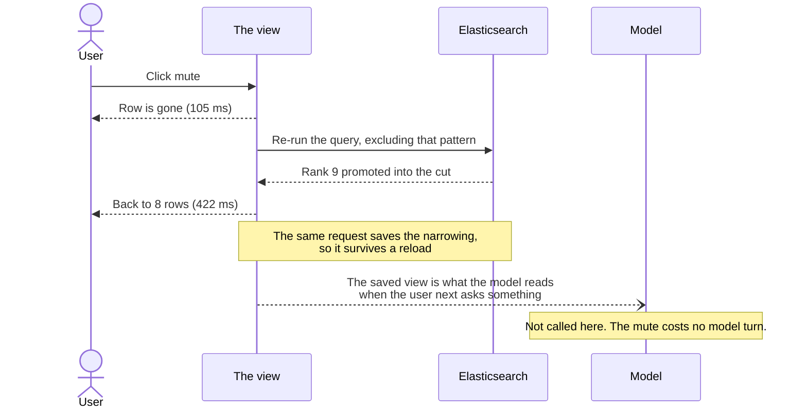

# Comment 1 of 3 — The journey this PoC implements

> **Draft, not posted.** Screenshot slots are marked `[SHOT n]` and listed at the bottom with what
> has to be visible in each. Nothing else is outstanding.
>
> **Audience:** anyone, including people who have never opened Agent Chat. No framework vocabulary.
> Attachments, versions, refs and `format()` belong in comment 2.

---

A user opens Agent Chat and asks what is noisy in their logs. The agent runs a query and renders a
table of log patterns ranked by count, each with a trend sparkline. From there the user works the
table directly: mute a pattern they already understand, move the time window, take one pattern and
compare it against an earlier period. When they ask the agent something, the answer is about the
table as it stands now rather than the one the agent rendered three turns ago.

A major goal of the journey is to explore a new interaction model within Agent
Chat. Narrowing the view is free. A mute is a click, not a reasoning turn. That
was spiked separately in #6064 before this PoC started, because if the most
common action in the product is also its slowest then the loop is not worth
building.

## The journey in one pass

### 1. Ask

`[SHOT 1]`

"What is noisy in my logs?" The agent chooses the pattern table without being told which view to use,
categorises the log messages over the window, and renders the top 8 by count with a sparkline on each
row.

The data never passes through the model. The tool runs the query and builds the
view server-side, and the model receives only an id to place in its reply. If
this dense table was instead routed through the model the turn would be slow,
lossy and unbounded, and cost would be in the range of three model calls and
154k input tokens to retype 14 rows.

### 2. Mute what you already understand

`[SHOT 2]`

Every row has a mute button. The row leaves the view at once. The table is a top-8 cut, so the query
then re-runs without that pattern and the ninth-ranked one moves up into the space. Muting the top
row of the seeded data promoted "Kafka consumer lag" at 83 documents into the cut.

Each mute leaves a chip above the table with a remove cross, so the narrowing is visible and
reversible, and it survives a page reload.

### 3. Move the window

`[SHOT 3]`

Both views carry a window picker with shift and zoom. Stepping back took the window from 16:44–18:44Z
to 14:44–16:44Z. Zooming out took two hours to three, and zooming in took three to one and a half,
both centred on the same point.

The table re-ranks underneath you. That run moved the counts from 270 to 257, 202 to 193, 135 to 129
and 45 to 43, with Kafka overtaking Disk at 30 against 29. No model turn.

On the comparison view the baseline period moves with the window, so the two periods stay the same
length and the same distance apart. Read back after four separate operations, the offset held at
exactly 3612484 ms every time, and the baseline length tracked the window at 120, 180 and 90 minutes.

### 4. Take one pattern and compare it against a baseline

`[SHOT 4]`

A row action scopes the journey to that single pattern and asks the agent to compare it against an
earlier period. The agent picks the comparison view and queries it, and the result draws as two
clustered bar series.

This one costs a turn, and the order matters. The scope is saved first, then the agent is asked, so
the agent is asked about a view that already exists rather than being asked to rebuild one. The
numbers line up with where the user came from: the histogram totalled 720 documents, which is exactly
the count shown on the row that was clicked.

### 5. Come back to the table

`[SHOT 5]`

One click in the header drops the scope and returns to the pattern table, keeping the window and any
mutes. Driven twice end to end: chip gone, 8 rows, fresh query, window preserved, and the header's
main action back to "Summarize top patterns".

The agent called the pattern tool with no parameters at all. Nothing about the user's accumulated
state had to be reconstructed from the conversation, which is the thing that tends to go wrong.

### 6. Ask a follow-up

`[SHOT 6]`

Short questions, of the kind people actually type. "Biggest?" "And now?" "Top pattern?" Across seven
rounds of mute-then-ask, every answer tracked the cut down as the mutes accumulated: 540, 360, 180,
150, 120, 90, 85.

Asked outright what window and filters were in effect, the agent answered "As of this reading: Time
window: `now-6h` to `now` … Muted patterns: none", and pointed out that the picker had moved since
the question was typed.

Keeping this reliable was the hardest part of the PoC and it is not fully closed. Before the fix, one
answer in five came from stale conversation text rather than from the current view. After it, zero in
seven, which at that rate happens by chance about one time in five. The direction is right and the
mechanism is understood. The rate is not established.

### 7. Ask for an interpretation

`[SHOT 7]`

Each view has one main action in its header. On the table it is "Summarize top patterns". On the
comparison it is "Explain this change".

The table's action started life as "Summarize remaining patterns", meaning list them with their
counts. That is the wrong job for the agent, because the user can already read the rows. It became
interpretation instead: which pattern dominates, what is rising, what is worth muting or investigating
next, with percentages scoped to the visible cut rather than to the whole index. When the answer
recommends something the table can do, it ends by re-rendering the live table so the user can do it.

"Explain this change" answered 600 documents against 426, a rise of 174 or 41%, and named the busiest
period in each epoch and the bucket that moved most, without reciting raw bucket values.

## Two kinds of button

`[SHOT 8]`

Buttons that change the view are plain. Buttons that start an agent turn carry a sparkle icon and a
tooltip that says so. A row carries three: mute, compare against a baseline, and Investigate.

Header actions are the exception on both counts. They cannot carry a tooltip, and below 560 px they
collapse to bare icons, where two sparkles side by side would be indistinguishable. The reason is a
framework limitation, covered in comment 2.

## What the agent sees while the user does this

Every time the agent answers, it re-reads the view as it currently stands: the window, the mutes, the
scope, the rows and their counts. It is also told when those numbers were fetched, so it can work out
that a reading has gone stale rather than having to be told that it might have.

There is a limit worth stating here rather than burying it. Earlier rounds stay in the conversation,
so the agent's own previous readings sit in its context going out of date while the user keeps
clicking. That is the source of the stale answers in step 6, and comment 2 covers why it is hard to
fix from our side.

## The loop

## One mute, end to end

The point of this one is what is missing from it.

## What the journey does not do yet

Two views and five interactions were the scoped slice, and the slice grew a little during the PoC.
What is not here:

- Drilling from a pattern into the sample log lines behind it.
- A pattern-by-time heatmap, showing which patterns fire when.
- A list of significant field values, meaning fields that are newly present or have shifted rate.
- Focusing the window onto a spike by selecting it on the chart, and filtering the table by log
  level. Both are designed and queued rather than built.

Comment 3 covers what the built operations suggest about the cost of the ones that were not.

---

## Screenshots to capture

One browser session, one conversation, in this order. Reseed first so counts are predictable
(`node __tmp__/seed_logs_poc.js`), and note that the seed is anchored to the moment it is run.

| Slot | What must be visible                                                                                                      |
| ---- | ------------------------------------------------------------------------------------------------------------------------- |
| 1    | First render: user prompt above, pattern table with 8 rows, sparklines, per-row actions, header with its one action       |
| 2    | After two mutes: 8 rows again (backfilled), two chips in the chip row, each with a remove cross                           |
| 3    | The window picker with all four shift and zoom buttons, ideally before and after so counts visibly change                 |
| 4    | The scoped volume comparison: two clustered bar series, the `Only:` chip, the "Explain this change" header action         |
| 5    | The header with "← Back to top patterns" beside the primary action                                                        |
| 6    | A short follow-up question and an answer naming the current top pattern and count, with the live table above it           |
| 7    | A Summarize answer that interprets rather than lists, ending in a re-rendered live table                                  |
| 8    | Close crop of one row's three actions (mute, compare, Investigate with its sparkle) plus a tooltip open                   |
| 9    | _Optional:_ a superseded earlier render showing the "Superseded" badge and disabled write buttons, for the fidelity point |

Open questions on the shots: light or dark theme, sidebar or full width (the header collapses to
icon-only below 560 px, which would undercut the labels in shots 1, 4 and 5), and whether to crop to
the attachment or keep the surrounding transcript. Keeping the transcript makes the "the agent
answers about the live view" point land on its own.

## Notes on this draft, not for posting

- **Steps 4 and 5 cost an agent turn**, and the draft says so rather than filing them under instant.
  The honest version of the claim is that the cheap actions are cheap and the ones needing reasoning
  are not, which is a better story than an overclaim that the first reader would catch.
- **The diagrams use solid against dotted lines rather than colour**, so they survive GitHub's dark
  theme. Neither has been rendered anywhere yet. The legend is a subgraph rather than a floating
  node; if it lands in an awkward place, the fallback is deleting it and putting the distinction in a
  sentence underneath.
- **Step 6 carries the stale-answer caveat** because it is a property of the journey and not only of
  the implementation. Moving it wholly into comment 3 would make this comment read better and less
  true.
- **The 154k-token trace in step 1** is from a service topology attachment, not from logs. It is the
  only measurement we have of the cost of routing a payload through the model, and the draft does not
  currently say it came from a different feature. Worth a clause if this is read closely.
- Every number is traceable to the state doc. Nothing here was re-derived from code.
