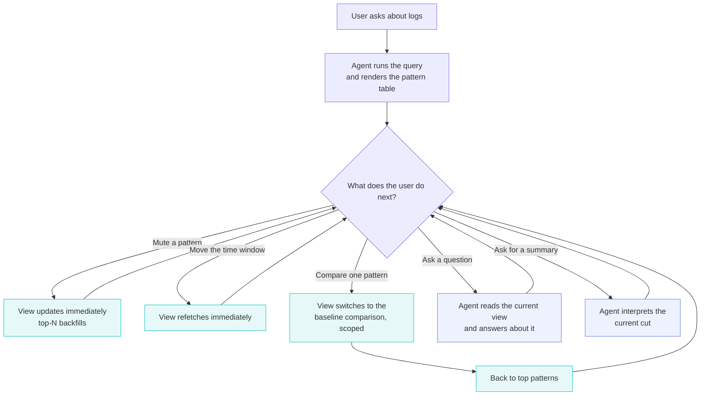
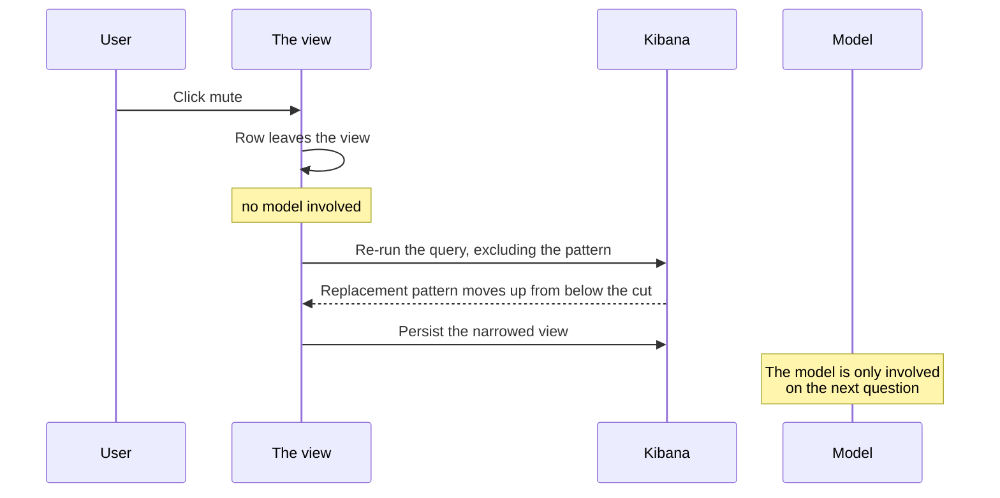

# Comment 1 of 3 — The journey this PoC implements

> **Status: rough structure.** Section headings, intent, and what each one pulls from. Prose not
> written yet. Screenshot slots are marked `[SHOT n]` and listed at the bottom with what has to be
> visible in each.
>
> **Audience for this comment:** anyone, including people who have never opened Agent Chat. No
> framework vocabulary at all. No `format()`, no attachments, no refs, no versions. Those belong in
> comment 2.

---

## 1. What the loop is

One paragraph. The user asks about logs, the agent renders a table of patterns, the user narrows it
by clicking, and the agent's later answers are about what is currently on screen rather than about
what it said earlier.

State the one claim the whole journey rests on: **narrowing the view does not cost a model turn.**
That is what #6064 was spiked to answer and what makes a mute-heavy loop viable at all.

## 2. The journey in one pass

A walkthrough, in the order a user would actually do it. Each step gets one or two sentences and a
screenshot. Keep it to what the user sees and does.

1. **Ask.** "What is noisy in my logs?" The agent picks the tool and the view without being told
   which renderer to use. `[SHOT 1]`
2. **Mute the noise you already understand.** Per-row action. The row leaves immediately and a
   replacement pattern moves up from below the cut. Chip appears, so the narrowing is visible and
   reversible. `[SHOT 2]`
3. **Move the window.** Shift back, zoom out, zoom in. Counts and ranking change under you. No model
   turn. `[SHOT 3]`
4. **Take one pattern and compare it against a baseline.** Row action switches the view to a volume
   comparison scoped to that pattern, and the agent explains it. `[SHOT 4]`
5. **Come back to the table.** One header click drops the scope and returns to the pattern table,
   with the window and any mutes still in effect. `[SHOT 5]`
6. **Ask a follow-up.** "What is the biggest one now?" The answer tracks the cut you have shaped,
   not the table from three turns ago. `[SHOT 6]`
7. **Ask for an interpretation.** The global action per view: "Summarize top patterns" on the table,
   "Explain this change" on the comparison. Output is interpretation rather than a re-listing of
   rows. `[SHOT 7]`

Pull the concrete numbers from the source draft's "What passes" list only where they make the story
concrete for a reader (for example, the compare-baseline histogram totalling exactly the count shown
in the clicked row). Keep the measurement detail in comment 2.

## 3. Two kinds of button, and telling them apart

Short. Instant actions change the view. Agent-turn actions start a new turn, carry a sparkle icon
and a tooltip saying so. Note the one exception, header actions, and why. `[SHOT 8]`

## 4. What the agent sees while you do this

Non-technical version only. The agent reads the current state of the view each time it answers, so
the mutes, the window and the scope reach it. One example of an answer that proves it.

Mechanism goes in comment 2. Resist explaining it here.

## 5. Diagrams

### 5a. The loop

Draft, for reaction:

Decide whether the colour split (instant against agent turn) is worth keeping or reads as noise in
GitHub's renderer. GitHub does render Mermaid `classDef`, but it is worth checking against the dark
theme before posting.

### 5b. One mute, end to end

The point of this diagram is the absence of the model. Draft:

### 5c. Optional third diagram

Only if the walkthrough needs it: compare-baseline, showing that the scope is persisted **before**
the turn starts, so the agent is asked about a view that already exists. Decide after the prose is
written. It may be redundant with step 4.

## 6. What the journey deliberately does not do yet

Short list, framed as scope rather than shortfall. Two renderers and five interactions were the
scoped slice. Name the operations from the spec that were not built and say that comment 3 covers
what this taught us about them.

---

## Screenshots to capture

One browser session, one conversation, in this order. Reseed first so counts are predictable
(`node __tmp__/seed_logs_poc.js`), and note that the seed is anchored to the moment it is run.

| Slot | What must be visible                                                                                                      |
| ---- | ------------------------------------------------------------------------------------------------------------------------- |
| 1    | First render: user prompt above, pattern table with 8 rows, sparklines, per-row actions, header with its one action       |
| 2    | After two mutes: 8 rows again (backfilled), two chips in the chip row, each with a remove cross                           |
| 3    | The window picker with all four shift and zoom buttons, ideally before and after so counts visibly change                 |
| 4    | The scoped volume comparison: two clustered bar series, the `Only:` chip, the "Explain this change" header action         |
| 5    | The header with "← Back to top patterns" beside the primary action                                                        |
| 6    | A short follow-up question and an answer naming the current top pattern and count, with the live table above it           |
| 7    | A Summarize answer that interprets rather than lists, ending in a re-rendered live table                                  |
| 8    | Close crop of one row's three actions (mute, compare, Investigate with its sparkle) plus a tooltip open                   |
| 9    | _Optional:_ a superseded earlier render showing the "Superseded" badge and disabled write buttons, for the fidelity point |

Open questions on the shots: light or dark theme, sidebar or full width (the header collapses to
icon-only below 560 px, which would undercut the labels in shots 1, 4 and 5), and whether to crop to
the attachment or keep the surrounding transcript. Keeping the transcript makes the "the agent
answers about the live view" point land on its own.
