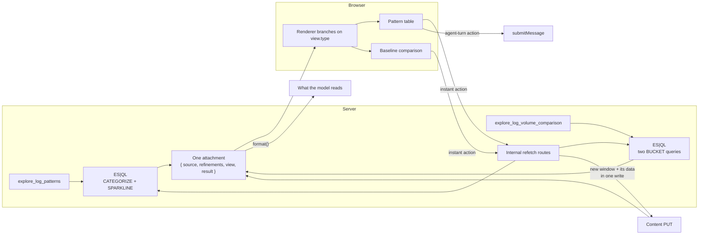

# Comment 2 of 3 — How it is built, and what had to be bent

> **Status: rough structure.** Section headings, intent, and the source lines each one pulls from.
> Prose not written yet.
>
> **Audience for this comment:** engineers, including the Agent Builder team. This is the comment
> that carries the framework findings, so it is the one worth writing most carefully. Everything in
> the current `6059-outcome-comment.md` under "Cost 1", "Cost 2" and "Cost 3" lands here, mostly as
> written.

---

## 1. Shape of the thing

One paragraph plus a diagram. Two ES|QL tools emit **one** attachment server-side, a renderer
branches on which view the attachment is carrying, and the user's clicks write back to that
attachment without a model turn.

Draft:

Two things to call out under the diagram, because they came free with the design and are easy to
miss:

- **The payload never routes through the model.** The tool queries and emits; the tool result carries
  only `attachment_ids`. The alternative, observed in a real trace, cost three LLM calls and 154k
  input tokens for a payload the model had to retype.
- **One query implementation, not two.** The refetch routes wrap the same handlers the tools call, so
  an instant refetch and an agent-driven query cannot disagree.

## 2. The payload model, and why it made extension cheap

Short section, because it is the part that generalises. `{ source, refinements[], view, result }`.
Mute, pattern scope and KQL are one union with one translation into DSL, one chip row and one merge
rule. `view` and `result` are discriminated unions on the same key, so a view cannot carry another
view's data.

Pull from the source draft's "A new way to narrow the data is cheap" and "A new lens is more
expensive but bounded". Include the evidence that the model earned its keep: before it existed the
volume comparison had no filter parameter at all, so muting in the table never reached the histogram
and nobody noticed.

## 3. The hurdles

The spine of this comment. Order them by how much they cost, not by when they were hit. Each gets:
what the framework does, what that forced, and the measurement.

### 3.1 Nothing in the contract can write attachment content

The five local edits to other teams' code. Take the "Cost 1" section from the source draft close to
as written, including the judgement about which are candidates for upstreaming and which were
expedient, and the caveat that upstreaming `updateContent` unchanged blesses the full-payload PUT.

Keep the inventory table from the state doc so the five files are named.

### 3.2 Identity is coupled to data freshness

Content writes must not invalidate. The 712 ms rebuild, the 20 ms sampling that caught a muted row
reappearing at t=405 and settling at t=1393, and the three-click sequence that landed on an
already-muted pattern because the reverted row came back under the pointer.

This is the single most expensive framework behaviour in the PoC. Consider giving it a diagram: the
two timelines side by side, with and without invalidation. Decide when writing whether the table
from the state doc is enough.

### 3.3 Two renders of one attachment never reconcile

Write-disabled-on-stale, what it contains, and the case it does not: `resolveAttachmentVersion` falls
back to the latest version when a round has no ref, so neither render knows it is stale. The
deliberate reproduction where a mute vanished.

Flag here that this is the ships-blocking one, and that the fix is delta writes rather than a patch.
Comment 3 carries the recommendation; this comment carries the mechanism.

### 3.4 `format()` did not reach the model for most of the PoC

`isReadonly: true`, found late. `prepareRoundInput` hardcodes `attachments: []`. The evidence that it
was really happening: the agent quoted `121, 143, 146` and "buckets 33 to 36 are 0", values that
exist only in the raw series.

Include the consequence for anyone reading our earlier notes: claims about model behaviour made
before that fix were measuring something else.

### 3.5 There is exactly one per-round channel to the model

Skill bodies are not reliably in context for button-triggered turns. `getAgentDescription()` is
injected once per conversation. So anything that must hold every round lives in `format()`.

Then the sharper half: a round with no attachment refs gets no attachment metadata and no type
description, and a content PUT attaches its ref to the last completed round, so "change the view,
then ask a question" produces exactly that round. The moment a reminder is most needed is the moment
none is sent. Hence the staleness stamp inside `format()`.

### 3.6 The small sharp edges

Short bullets, no ceremony. `maxContentLength` declared and never enforced, so every zod bound has to
do real work, and three of ours were wrong. `AttachmentHeader` returning `null` with no buttons and
taking the title and badges with it. Invalid EUI icon names failing silently. The DOM-nesting
warnings, with the correction that they are pre-existing framework behaviour and not a cost of this
PoC.

### 3.7 One finding that is not Agent Builder's

The Elasticsearch `must_not` behaviour. Isolated against 9.6.0-SNAPSHOT, the query shapes tested, the
3685 / 3685 / 360 measurement, and the fix of always emitting a positive clause. Say plainly that
nothing has been filed.

Decide before posting whether this belongs in a comment on this issue at all, or whether it should be
its own issue against Elasticsearch with this as a pointer.

## 4. What type-checking did not catch

Six bugs, all of which passed type-check, lint and unit tests. Three were visible only by driving the
running UI. List them compactly, because the list is the argument for the next section.

Worth naming the two that are about the model rather than the code, since they are the least
familiar failure mode: a rule in `format()` being read as licence to answer without reading, and the
same miscount returning because a sentence moved away from the rows it introduced.

## 5. What is left in the working tree

Short and unambiguous. Five files touched outside our plugin, none of them a PR, all of them
reverted or upstreamed before anything ships. Point at the inventory rather than repeating it.

---

## Decisions to make before writing this one

- **Depth.** The source draft's three cost sections are already close to publishable. The question is
  whether this comment adds the architecture diagram and the payload-model section, which the source
  draft does not have, and how much of the hurdle detail survives at that length.
- **Whether the "sharp edges" list is worth the space** or whether it should collapse into one
  sentence plus a link, so the three big hurdles keep the reader's attention.
- **Whether to include the version and ref cost here or in comment 3.** It is a framework defect
  (mechanism, so comment 2) and also an argument about whether the primitive is right (verdict, so
  comment 3). Pick one and cross-reference.
