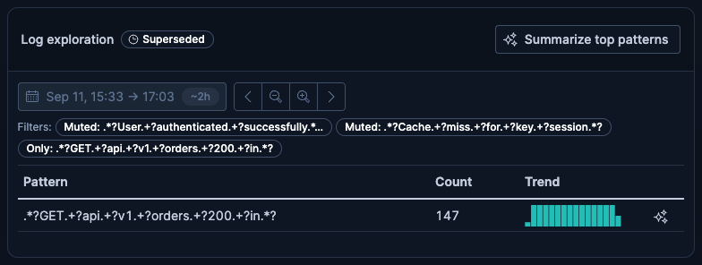

# Comment 2 of 3 — How it is built, and what we had to work around

> **Draft, not posted.** Images are repo-relative and need uploading when this goes to GitHub.
> Working notes are below the line at the bottom.

---

The previous comment showed the loop from the outside. This one covers how it is built and what we
had to work around to build it. Most of what follows is not specific to logs: the same hurdles would
face anything trying to put an interactive, writable view inside Agent Chat.

## Shape of it

Two ES|QL tools emit **one** attachment, server-side. Either can open the journey: the agent picks
whichever fits the question, whichever runs first creates the attachment, and the other updates that
same one. A renderer branches on which view the attachment is carrying, and
the user's clicks write back to it without a model turn.


Hexagons are tools the agent can call. Double-bordered boxes are plain
functions. Slanted boxes are HTTP endpoints. The cylinder is the stored
attachment, and plain boxes are rendered UI.

The two function boxes in the browser, `updateContent()` and `submitMessage()`, are the two
capabilities the attachment contract did not have. Hurdle 1 covers what adding them cost.

Two consequences follow.

**The payload never routes through the model.** The tool runs the query and calls `attachments.add`
itself; the tool result carries only `attachment_ids`, so the model places a `<render_attachment>`
tag and never sees a row. We have a trace of the alternative: a service-topology attachment built the
other way cost three model calls and 154k input tokens for a fourteen-connection payload the model
had to retype into tool parameters, with nothing checking that what it retyped matched what the tool
had returned.

**Both paths share one query implementation.** The instant-refetch routes wrap the same handler
functions the tools call, so a refetch and an agent-driven query cannot disagree.

## The payload model

This part generalises beyond logs. The attachment holds `{ source, refinements[], view, result }`: a
subject, the narrowings applied to it, the lens it is viewed through, and a cache of what that lens
last returned.

Mute, pattern scope and KQL are all members of one `Refinement` union, with one translation into DSL,
one chip row and one merge rule. Adding a kind of narrowing costs a case in `buildRefinementFilter`
and a control, and nothing else. `view` and `result` are discriminated unions on the same key, so a
`volume-comparison` view cannot carry pattern-table data.

Introducing this model surfaced a bug nobody had noticed. Before it existed, `getLogVolumeComparison`
took only a `kqlFilter` and had no way to receive mutes at all, so muting noise in the table never
reached the histogram. Once refinements narrowed the subject rather than the renderer, both lenses
honoured them by construction.

The cost is that switching lens discards the other lens's cached result, so switching back
re-queries.

## The hurdles

Ordered by how much they cost.

### 1. Nothing in the browser contract can write attachment content

This is the one with consequences outside our own plugin. Making a click change an attachment took
five local edits to code owned by other teams. **None is a PR, and nothing ships until they are
reverted or upstreamed.**

| File                                                                 | Change                                                                                                                                                                                                   |
| -------------------------------------------------------------------- | -------------------------------------------------------------------------------------------------------------------------------------------------------------------------------------------------------- |
| `agent-builder-server/allow_lists.ts`                                | Two tool ids, one skill id, one attachment type id. `register*` throws without them                                                                                                                      |
| `agent_builder/server/routes/attachments.ts`                         | Content PUT passes `ATTACHMENT_REF_ACTOR.user` and calls `addAttachmentsToLastRound` instead of `client.update`, so the round ref advances. Falls back to the old path when a conversation has no rounds |
| `agent-builder-browser/attachments/contract.ts`                      | Optional `updateContent` and `submitMessage` on `GetActionButtonsParams` and `InlineRenderCallbacks`                                                                                                     |
| `agent_builder/public/services/attachments/attachements_service.tsx` | Added `updateContent`                                                                                                                                                                                    |
| `agent_builder/public/.../inline_attachment_with_actions.tsx`        | Wired both capabilities into its two renderer call sites; added a `useSubmitMessage` mock to its test                                                                                                    |

In substance they add two capabilities the contract does not have, plus two changes that are not
additions.

**A content write.** `updateContent` on `AttachmentsService`, mirroring the existing `updateOrigin`
http wrapper, plus the optional callback on the two renderer interfaces. Optional because six
consumer test files hand-construct those params. The public
`PUT /api/agent_builder/conversations/{id}/attachments/{id}` endpoint already existed, with no caller
anywhere in Kibana and no browser wrapper, which #6064 established. **This is a candidate for
upstreaming close to as written**, with one caveat: upstreaming it unchanged blesses the
full-payload PUT as the write shape for attachment content, which is what breaks under concurrency.
See hurdle 3.

**A way for a renderer to start an agent turn.** Optional `submitMessage` on the same two interfaces,
wired from `useSubmitMessage()`. Nothing else in the contract can do this. `openChat` silently drops
`initialMessage` into an already-open conversation and targets a different React root. **The shape is
right and the semantics need the owning team.** `useSubmitMessage` calls `sendMessage` with no
in-flight gate, and a handler has no way to signal that the write the turn depends on has failed.
Both of those are open defects below.

**The allow-list entry** is the gate working as designed. `registerType` throws without it, which
forces a conversation with the Agent Builder team before any of this is real.

**The content-update route change is expedient.** The route computes the correct ref and never
persists it to the round, so the framework re-renders the stale pinned version even though
`versions[]` already holds the new one. We made it attach the ref to the last completed round. That
makes writes visible, and it also produces the two defects #6064 already flagged: one ref appended
per click, unbounded, and version chips placed beside the user's prompt under a hardcoded "Added"
label. The correct version of this change collapses refs and attributes button-driven edits properly.
That is a design call for the Agent Builder team.

### 2. Identity is coupled to data freshness

The most expensive framework behaviour here. The pinned version both selects the data and forms the
`AttachmentRenderErrorBoundary` key (`id:version`). A ref that does not advance keeps the key stable
and renders stale content; a ref that advances refreshes the content and always moves the key. No
configuration gives a plain re-render with fresh data.

So content writes must not call `invalidateConversation()`. Measured, both ways:

|                                  | Without invalidation (shipped) | With invalidation (experiment)            |
| -------------------------------- | ------------------------------ | ----------------------------------------- |
| Row disappears                   | ~50 ms                         | ~50 ms (local state)                      |
| Subtree rebuilt                  | never                          | ~712 ms after every click                 |
| Network per click                | one ~16 KB PUT                 | ~16 KB PUT + two ~40 KB conversation GETs |
| Clicking faster than the rebuild | correct                        | rows revert on screen                     |

That last row is the reason we do not invalidate. Sampled every 20 ms across two mutes 200 ms apart:

```
t=38    5 rows   mute #1 applied locally
t=257   4 rows   mute #2 applied locally
t=405   5 rows   <- muted row REAPPEARS
t=1393  4 rows   settles once mute #2's write lands
```

A three-click sequence then landed its third click on an already-muted pattern, because the reverted
row returned to position 0 under the pointer. Nothing was lost only because the mute action is
idempotent.

Invalidating is not incorrect. Writes are serialised and the rebuild re-seeds from a server that
already holds every mute, so the data converges. The cost is the visible revert and the network
amplification.

### 3. Two renders of one attachment never reconcile

The attachment renders in more than one round, and without invalidation those instances never
reconcile. Muting in an older render PUT a full payload derived from its stale base and destroyed a
newer mute.

The containment is to disable writes where `version < versionCount`. On a superseded render the
window picker and all four shift and zoom buttons are `disabled`, the chips lose their remove
crosses, the mute and compare actions disappear from every row, and only the agent-turn action
remains:



Agent-turn actions stay enabled on purpose: they only send a prompt, and the agent reads live state.
An earlier attempt suppressed every action instead, and `AttachmentHeader` returns `null` when it has
no buttons, which deleted the title, the icon and the "Superseded" badge that explained why the
buttons were gone.

**It does not contain the case where neither round carries a ref.** `resolveAttachmentVersion` falls
back to `versions.at(-1)`, so both renders resolve to the latest version, `version < versionCount`
never fires, and neither is marked superseded. No badge, all buttons enabled. Reproduced
deliberately: muting in the new render left the pattern listed in the old one, and muting a different
row in the old render then reloading showed the new render's mute gone, its pattern back and no chip.

A mounted render cannot discover that it has been superseded: props stay frozen and content writes
must not invalidate. Nothing in the existing API detects it either. `stale_check.ts` covers origin
staleness rather than version concurrency, and the content-update route belongs to Agent Builder.
**This defect blocks shipping.** The fix is delta writes (`{ mute: pattern }`) replacing
full-payload PUTs, which is an API design question. The third comment carries the
recommendation.

### 4. `format()` did not reach the model for most of this PoC

Found late, and it invalidates a lot of our earlier notes. `prepareRoundInput` hardcodes
`attachments: []`, so the `representation.value` path in `to_langchain_messages` is dead. Each round
gets `attachment_context`: metadata only, plus a note telling the model to call `attachment_read`.
**That read returns the raw payload unless the type sets `isReadonly: true`.** Ours did not.

Every rule in `format()` was dead code, and the agent was reasoning off raw JSON. Observed directly:
it quoted `121, 143, 146` and "buckets 33 to 36 are 0", values that appear only in the raw series and
never in the formatted representation.

Setting the flag is safe: `readonly` is enforced only in the agent's builtin add and update tools, so
the tool emit path and the user's writes are unaffected. But any claim we made about model behaviour
before this fix was measuring something else.

### 5. There is one per-round channel, and it goes missing when it is needed most

There are three candidate places to put text the model must see every turn. Only one works.

- **The skill body** is not reliably in context for button-triggered turns. An "Explain this change"
  round showed no `load_skill` call at all.
- **`getAgentDescription()`** is injected once per conversation per type.
- **`format()`**, reached through `attachments.read`, is the only per-round channel.

So anything that has to hold every turn lives in `format()`, which is why it carries the muted-pattern
rules, the top-N framing, each row's share of the cut and a trend token.

A related gap is worse, and we recorded it rather than working around it. `prepareRoundInput` gates
the whole `inputAttachments` block on `if (input.attachment_refs)`, and the
`formatAttachmentsMetadata` fallback sits _inside_ that branch. A round with no refs therefore gets
no attachment metadata and no type description. Confirmed live: `refs: []` produces
`attachment_context: false`. Because a content PUT attaches its ref to the last completed round,
changing the view and then asking a question produces exactly that round. **The moment a reminder is
most needed is the moment none is sent.**

It gets worse. `convertPreviousRounds` replays earlier tool results as `ToolMessage`s and
`ignoreSteps` is never set true by any caller, so an earlier reading of the attachment stays in
context going stale. That makes the agent's own previous words the strongest stale source in the
transcript.

Instead of working around it, `format()` now ends by stamping when its numbers were fetched, so the
model can compare that against the `[Sent: …]` timestamp on the message it is answering. Staleness
becomes checkable rather than asserted. A standing "always read an attachment before referencing its
content" rule is already in the system prompt every round, so restating it again would not have
helped.

### 6. Sharp edges

Each of these is a small fix, and each one cost time to find.

- **`maxContentLength` on `AttachmentTypeDefinition` is declared and never enforced.** Every zod bound
  has to do real work. Three of ours were wrong before they were re-derived, in the direction where a
  tool input the schema accepted could produce an attachment that then failed validation.
- **`AttachmentHeader` returns `null`** when it has no action buttons, taking the title, icon and
  badges with it. A lens must never register zero.
- **A missing version renders as `null` with no diagnostic.** If an attachment silently disappears
  rather than erroring, check the round's `attachment_refs` against the stored versions first.
  Nothing in the UI says so.
- **`ActionButton` exposes a tooltip only through `disabledReason`**, so no header action can carry
  one. Below 560 px they also collapse to bare icons, where two sparkle icons are indistinguishable.
- **Invalid EUI icon names fail silently.** `eyeClosed` is not an icon; EUI ships `eye` and
  `eye_slash`. No type error, no lint error, no runtime error.
- **DOM-nesting warnings come from the framework.** Inline renders live inside a
  markdown `<p>`, and the framework's own `EuiSplitPanel.Outer` is already a `div` inside it. Every
  attachment type with `renderInlineContent` hits this. Hoisting block nodes out of paragraphs in the
  markdown plugin would clear it for all of them at once.
- **Ref accumulation.** One ref entry appended per button click, unbounded. Six observed on a single
  round after five mutes. Every refetch also cuts a version. More interaction makes this worse rather
  than different.

## What the tests did not catch

Six bugs were found while building this. **All six passed type-check, lint and unit tests.** Three
were visible only by driving the running UI.

1. **Time-range trap.** `loopState.timeRange ?? { start, end }` made loop state win unconditionally,
   so the first emitted range became permanent and the agent could never widen a window that returned
   nothing. It saw an empty result and concluded the data was missing.
2. **Cross-render clobber.** Hurdle 3 above, found by muting in an older render.
3. **Disappearing header.** The first read-only implementation suppressed every action, and
   `AttachmentHeader` returned `null`.
4. **Unmute restored a row with a stale count.** A refetch drops muted patterns from the payload, so
   the client retains the last-seen entry to make unmute possible at all. Restoring it after a range
   change put a count from the old window into a table whose other rows belonged to the new one.
5. **The write flush did not cover refetches.** An agent turn started right after a range change
   could read the old window, because the flush awaited only the write queue and not the in-flight
   fetch.
6. **The dataset could not exercise the top-N.** Seven categories against a limit of 25 meant muting
   could never promote a new pattern, so the backfill looked correct only because nothing was ever
   cut.

Two more belong in a separate category, because they are about the model rather than the code:

- **A writing rule was read as a reading rule.** "Prefer saying what the user cannot already see"
  appeared unscoped, and the model took it as licence to answer without reading the attachment at
  all. It answered about a pattern that was muted, quoting a count from an older window, while the
  live top row said something else. Fixed by scoping the rule to what the model _writes_.
- **A miscount came back because a sentence moved.** The un-muted count was stated in `format()`
  immediately before the row list. Inserting two explanatory paragraphs between them was enough for
  the model to go back to computing the count itself, wrongly. A rule in `format()` is only as strong
  as its adjacency to what it governs.

## What is left in the working tree

Five files touched outside our own plugin, listed in hurdle 1. None is a PR. All of them are reverted
or upstreamed before any of this ships, and two of them need the Agent Builder team to decide the
right shape rather than take ours.

The third comment covers whether to build this properly, and what the framework would need to offer
for it to be a supported pattern rather than a PoC.

---

# Working notes below this line. Not part of the comment.

## Decisions taken while writing

- **Depth: kept the architecture diagram and the payload-model section**, neither of which is in
  `6059-outcome-comment.md`. The diagram covers the emit-server-side arrangement, which is the part
  another team is most likely to copy. The payload section covers the only design decision that made
  later work faster rather than slower.
- **Kept the sharp-edges list in full** rather than collapsing it to a sentence. Every item is a
  small fix for the Agent Builder team and most took an hour to find. Collapsing them would save the
  reader thirty seconds and lose the only place they are written down.
- **Ref accumulation sits here, in hurdle 6**, as a framework defect with a measurement. The argument
  about whether the primitive is right belongs in the third comment, which should cross-reference
  rather than repeat.
- **The architecture diagram was redrawn** so both tools hang off the agent symmetrically. The first
  version put `explore_log_patterns` on the top line with the comparison under it, which read as a
  primary path and a secondary one. They are two entry points and the agent chooses between them.
  The redraw also splits the tools from the handler functions, so the shared query implementation
  shows up in the diagram instead of only in the text underneath.
- **The diagram uses `TB`.** An `LR` version with `direction TB` inside each subgraph was
  tried first; Mermaid ignores subgraph direction once edges cross the subgraph boundary, confirmed
  by rendering it. `TB` also suits the comment column better, since the graph is about seven ranks
  deep and `LR` squeezed it sideways.
- **Node kinds are distinguished by shape**: hexagon for a tool, subroutine box for a
  function, parallelogram for an HTTP endpoint, cylinder for stored state. Colour would read more
  easily but has to survive GitHub's light and dark themes, and the comment 1 diagrams already avoid
  it for that reason. If the shapes do not land, `classDef` fills are the fallback and want checking
  in both themes.
- **The attachment node lost its braces.** `{ source, refinements, view, result }` became a plain
  comma list, because braces inside a cylinder label are the kind of thing Mermaid parses badly. The
  payload shape is written out in full in the payload-model section anyway.
- **The diagram had the write path wrong and it is now fixed.** An earlier version drew
  `refetch route --> content PUT`, which claims the route performs the write. It does not: the routes
  are stateless wrappers over the query handlers, and the renderer is what calls the refetch route,
  takes the result, and then makes the content PUT itself. That is the whole point of the
  "persist the window and its data in one write" rule, and the diagram was contradicting it. The
  content PUT also moved inside the Server subgraph, since it is a server endpoint that the browser
  calls rather than something floating between the two.
- **The loop now closes on the agent.** `submitMessage()` and `format()` both point back at the
  agent node, which removed two dangling leaf nodes and shows the two ways the agent re-enters:
  a button starting a turn, and the formatted attachment being read on the next turn.
- **`updateContent()` is drawn explicitly** rather than having the renderer call the PUT directly.
  It costs one node and makes the browser's two subroutine boxes exactly the two capabilities that
  had to be added to the contract, which is the subject of hurdle 1. The sentence under the diagram
  makes that link rather than leaving the reader to notice it.
- **Every user interaction now originates at a lens**, and the two kinds are symmetric: an instant
  action goes to the refetch route and on into `updateContent()`, an agent-turn action goes to
  `submitMessage()`. An earlier version routed instant actions through the renderer node while
  agent-turn actions went straight to `submitMessage()`, which was two levels of abstraction for the
  same kind of thing. This also fixed a smaller error, where only the pattern table had an agent-turn
  edge; the comparison has "Explain this change" and "Back to top patterns", so both lenses reach it.
- **The diagram's arrows show flow.** They are not a call graph. The renderer's state hook is what
  actually calls the refetch route and `updateContent()`; the lenses dispatch. Drawing the true call
  graph meant routing every action
  through the renderer node and made the picture harder to read for no gain, since `A --> V` was
  already a data-flow arrow.
- **The Elasticsearch finding is deliberately not here.** An ES|QL query-shape bug cost real time
  during the PoC and is written up in the state doc, but it is aimed at a team that will never read
  this thread, and it is not a finding about Agent Builder. Reporting it wants its own issue against
  Elasticsearch rather than a paragraph in this one.

## Open questions

- **Length.** Around 2,100 words and one screenshot. Longer than the first comment, but the audience
  is engineers and the hurdle sections are the reason the comment exists.
- The five-file table repeats what is in the state doc. If that doc is ever published, the table
  should become a link.
