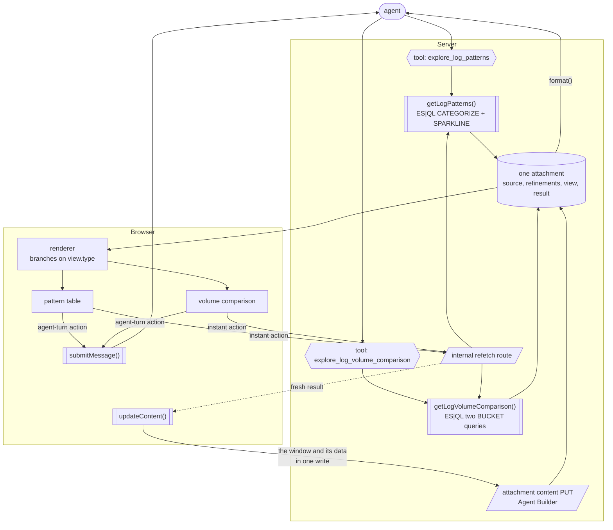

# Comment 2 of 3 — How it is built, and what got in the way

> Posted as https://github.com/elastic/observability-dev/issues/6059#issuecomment-5668449722

---

The previous comment showed the loop from the outside. This one explains how it is built and where the current attachment contract falls short of an interactive, writable view in Agent Chat. Little of it is specific to logs.

## Architecture

Two ES|QL tools emit **one** attachment on the server. The agent selects the tool that fits the question. The first creates the attachment; the other updates it. The renderer branches on the attachment's view, and user clicks write back without a model turn.

The single-attachment-approach arises from a technical limitation of the attachment contract. `AttachmentRenderProps` carries only the attachment being rendered, with no sibling access and no conversation id, so a renderer cannot read or write any other attachment. Splitting immutable tool output from mutable user state across two attachments is the cleaner design, but the contract cannot express it. Everything lives in one payload and the renderer branches on a field inside it. The same gap is what ruled out the renderer self-fetch approach in #6064.

Hexagons are tools the agent can call. Double-bordered boxes are plain functions. Slanted boxes are HTTP endpoints. The cylinder is the stored attachment, and plain boxes are rendered UI.

The two function boxes in the browser, `updateContent()` and `submitMessage()`, are the two capabilities the attachment contract does not have. Hurdle 1 covers both.

This has two consequences.

**The payload never routes through the model.** The tool runs the query and calls `attachments.add` itself; the tool result carries only `attachment_ids`, so the model places a `<render_attachment>` tag and never sees a row. The alternative, which the existing service-map attachment uses, returns the data to the model and has it retype the payload into tool parameters. That spends extra model calls and an input-token bill that scales with the size of the result, and nothing checks that what the model retyped matches what the tool returned.

**Both paths share one query implementation.** The instant-refetch routes wrap the same handler functions the tools call, so a refetch and an agent-driven query cannot disagree.

## Attachment data model

This model generalises beyond logs. The attachment holds `{ source, refinements[], view, result }`: a subject, the narrowings applied to it, the lens it is viewed through, and a cache of what that lens last returned.

Mute, pattern scope, and KQL are members of one `Refinement` union, with one DSL translation, chip row, and merge rule. Adding a refinement requires a case in `buildRefinementFilter` and a control. `view` and `result` are discriminated unions on the same key, so a `volume-comparison` view cannot carry pattern-table data.

Because refinements narrow the subject instead of the renderer, every lens honours them by construction. The cost is that switching lens discards the other lens's cached result, so switching back re-queries.

## Chat/Attachment limitations

### Nothing in the browser contract can write attachment content

Making a click inside an attachment renderer change the attachment itself requires several edits to code owned by various teams, so this does not run on stock Kibana.

**Ability to write attachment content.** `updateContent` on `AttachmentsService`, mirroring the existing `updateOrigin` http wrapper, plus the optional callback on the two renderer interfaces. Optional because existing consumer tests hand-construct those params. The public `PUT /api/agent_builder/conversations/{id}/attachments/{id}` endpoint already existed, with no caller anywhere in Kibana and no browser wrapper, which #6064 established.

**A way for a renderer to start an agent turn.** An optional `submitMessage` on the same two interfaces, wired from `useSubmitMessage()`. Nothing else in the contract can do this. `openChat` silently drops `initialMessage` into an already-open conversation and targets a different React root. `useSubmitMessage` calls `sendMessage` without an in-flight gate, and a handler cannot report that a required write failed. Both are open defects below.

**The content-update route change is a stopgap.** The route computes the correct ref but does not persist it to the round. The framework therefore re-renders the stale pinned version even though `versions[]` already contains the new one. Attaching the ref to the last completed round makes writes visible, but it also creates the two defects #6064 already flagged: an unbounded ref entry per click, and version chips beside the user's prompt under a hardcoded "Added" label. The right design would collapse refs and correctly attribute button-driven edits. That is a decision for the Agent Builder team.

### Renderer identity is coupled to data freshness

This significantly shaped the renderer's behavior and its optimistic update strategy. The pinned version both selects the data and forms the `AttachmentRenderErrorBoundary` key (`id:version`). A ref that does not advance keeps the key stable and renders stale content; a ref that advances refreshes the content and always moves the key. None of the possible configurations give a plain re-render with fresh data.

So content writes must not call `invalidateConversation()`. With invalidation, every click tears down and rebuilds the attachment's whole subtree and refetches the conversation on top of the write. Without it, the click updates local state and sends a single PUT.

The rebuild is slower than a person clicking. When the first click's rebuild arrives with older data, it undoes a locally applied second click and returns the row to its old position until the second write lands. The next click can then land on whatever moved under the pointer. Nothing is lost only because the mute action is idempotent. So it doesn't generalize to non-idempotent actions.

Invalidating is not incorrect, just not conducive to fast interactive updates. So if a rebuild happens, it re-seeds from a server that already holds every mute, so the data converges. The cost is the visible revert and the network amplification.

### Two renders of one attachment never reconcile

The attachment will usually be rendered in more than one round, and without invalidation those instances never reconcile. Muting in an older render PUTs a full payload derived from its stale base, destroying any newer mute.

The work-around is to disable writes where `version < versionCount`. On a superseded render, the window picker and all four shift and zoom buttons are `disabled`, chips lose their remove crosses, mute and compare actions disappear from every row, and only the agent-turn action remains:

Agent-turn actions stay enabled on purpose: they only send a prompt, and the agent reads live state.

This safeguard fails when neither round carries a ref, though. `resolveAttachmentVersion` falls back to `versions.at(-1)`, so both renders resolve to the latest version, `version < versionCount` never fires, and neither is marked superseded. There is no badge and all buttons remain enabled. Muting in the newer render leaves the pattern listed in the older one. Muting a different row in the older render and then reloading removes the newer render's mute, restores its pattern, and removes the chip.

A mounted render cannot discover that it has been superseded: props stay frozen and content writes must not invalidate due to reasons explained above. Nothing in the existing API detects it either. `stale_check.ts` covers origin staleness rather than version concurrency, and the content-update route belongs to Agent Builder.

A possible fix woulld be delta writes (`{ mute: pattern }`) replacing full-payload PUTs, but that is an API design question.

### `format()` reaches the model only if the type opts in

`prepareRoundInput` hardcodes `attachments: []`, so the `representation.value` path in `to_langchain_messages` is dead. Each round gets `attachment_context`: metadata only, plus a note telling the model to call `attachment_read`. **That read returns the raw payload unless the type sets `isReadonly: true`.** Without the flag, every rule in `format()` is dead code and the agent reasons off raw JSON. The tell is the agent quoting bucket values and array positions that exist only in the stored series and never appear in the formatted representation.

Setting the flag is safe: `readonly` is enforced only in the agent's builtin add and update tools, so the tool emit path and the user's writes are unaffected.

### There is one per-round channel, and it goes missing when it is needed most

There are three places to put text the model must see on every turn. Only one works.

- **The skill body** is not reliably in context for button-triggered turns; such a round can arrive with no `load_skill` call at all.
- **`getAgentDescription()`** is injected once per conversation per type.
- **`format()`**, reached through `attachments.read`, is the only per-round channel.

Anything the model must receive on every turn therefore lives in `format()`. It carries the muted-pattern rules, top-N framing, each row's share of the cut, and a trend token.

A related gap is more serious. `prepareRoundInput` gates the whole `inputAttachments` block on `if (input.attachment_refs)`, and the `formatAttachmentsMetadata` fallback sits _inside_ that branch. A round with no refs therefore gets no attachment metadata and no type description: `refs: []` produces `attachment_context: false`. Because a content PUT attaches its ref to the last completed round, changing the view and then asking a question produces exactly that round. **The moment a reminder is most needed is the moment none is sent.**

It gets worse. `convertPreviousRounds` replays earlier tool results as `ToolMessage`s and `ignoreSteps` is never set true by any caller, so an earlier reading of the attachment stays in context going stale. That makes the agent's own previous words the strongest stale source in the transcript.

A plugin cannot close that gap, so `format()` ends with the time its numbers were fetched. The model compares that time with the `[Sent: …]` timestamp on the message it is answering. This makes staleness checkable rather than assumed. A standing "always read an attachment before referencing its content" rule already appears in the system prompt every round, so repeating it does not help.

Writing for that channel has failure modes that a type-checker cannot catch:

- **A writing rule gets read as a reading rule.** An unscoped "prefer saying what the user cannot already see" reads as licence to answer without opening the attachment at all, so the agent answers from what it remembers about state that has since changed. Scoping the rule to what the model _writes_ fixes it.
- **A rule is only as strong as its adjacency to what it governs.** A count stated immediately before the row list holds. Put explanatory prose between the two and the model goes back to computing the count itself, wrongly.

### Other sharp edges

Each of these needs a small framework fix and is easy to miss.

- **`maxContentLength` on `AttachmentTypeDefinition` is declared and never enforced.** Every zod bound has to do real work, and a tool input the schema accepts can produce an attachment that then fails validation.
- **`AttachmentHeader` returns `null`** when it has no action buttons, taking the title, icon and badges with it. A lens must never register zero.
- **A missing version renders as `null` with no diagnostic.** If an attachment silently disappears rather than erroring, check the round's `attachment_refs` against the stored versions first. Nothing in the UI says so.
- **`ActionButton` exposes a tooltip only through `disabledReason`**, so no header action can carry one. Below 560 px they also collapse to bare icons, where two sparkle icons are indistinguishable.
- **DOM-nesting warnings come from the framework.** Inline renders live inside a markdown `
`, and the framework's own `EuiSplitPanel.Outer` is already a `div` inside it. Every attachment type with `renderInlineContent` hits this. Hoisting block nodes out of paragraphs in the markdown plugin would clear it for all of them at once.
- **Ref accumulation.** Each button click appends an unbounded ref entry, and every refetch also creates a version. More interaction compounds both problems.

---

# Working notes below this line. Not part of the comment.

## Decisions taken while writing

- **Depth: kept the architecture diagram and the payload-model section**, neither of which is in `6059-outcome-comment.md`. The diagram covers the emit-server-side arrangement, which is the part another team is most likely to copy. The payload section covers the only design decision that made later work faster rather than slower.
- **Kept the sharp-edges list in full** rather than collapsing it to a sentence. Every item is a small fix for the Agent Builder team and most took an hour to find. Collapsing them would save the reader thirty seconds and lose the only place they are written down.
- **Ref accumulation sits here, in hurdle 6**, as a framework defect with a measurement. The argument about whether the primitive is right belongs in the third comment, which should cross-reference rather than repeat.
- **The architecture diagram was redrawn** so both tools hang off the agent symmetrically. The first version put `explore_log_patterns` on the top line with the comparison under it, which read as a primary path and a secondary one. They are two entry points and the agent chooses between them. The redraw also splits the tools from the handler functions, so the shared query implementation shows up in the diagram instead of only in the text underneath.
- **The diagram uses `TB`.** An `LR` version with `direction TB` inside each subgraph was tried first; Mermaid ignores subgraph direction once edges cross the subgraph boundary, confirmed by rendering it. `TB` also suits the comment column better, since the graph is about seven ranks deep and `LR` squeezed it sideways.
- **Node kinds are distinguished by shape**: hexagon for a tool, subroutine box for a function, parallelogram for an HTTP endpoint, cylinder for stored state. Colour would read more easily but has to survive GitHub's light and dark themes, and the comment 1 diagrams already avoid it for that reason. If the shapes do not land, `classDef` fills are the fallback and want checking in both themes.
- **The attachment node lost its braces.** `{ source, refinements, view, result }` became a plain comma list, because braces inside a cylinder label are the kind of thing Mermaid parses badly. The payload shape is written out in full in the payload-model section anyway.
- **The diagram had the write path wrong and it is now fixed.** An earlier version drew `refetch route --> content PUT`, which claims the route performs the write. It does not: the routes are stateless wrappers over the query handlers, and the renderer is what calls the refetch route, takes the result, and then makes the content PUT itself. That is the whole point of the "persist the window and its data in one write" rule, and the diagram was contradicting it. The content PUT also moved inside the Server subgraph, since it is a server endpoint that the browser calls rather than something floating between the two.
- **The loop now closes on the agent.** `submitMessage()` and `format()` both point back at the agent node, which removed two dangling leaf nodes and shows the two ways the agent re-enters: a button starting a turn, and the formatted attachment being read on the next turn.
- **`updateContent()` is drawn explicitly** rather than having the renderer call the PUT directly. It costs one node and makes the browser's two subroutine boxes exactly the two capabilities that had to be added to the contract, which is the subject of hurdle 1. The sentence under the diagram makes that link rather than leaving the reader to notice it.
- **Every user interaction now originates at a lens**, and the two kinds are symmetric: an instant action goes to the refetch route and on into `updateContent()`, an agent-turn action goes to `submitMessage()`. An earlier version routed instant actions through the renderer node while agent-turn actions went straight to `submitMessage()`, which was two levels of abstraction for the same kind of thing. This also fixed a smaller error, where only the pattern table had an agent-turn edge; the comparison has "Explain this change" and "Back to top patterns", so both lenses reach it.
- **The diagram's arrows show flow.** They are not a call graph. The renderer's state hook is what actually calls the refetch route and `updateContent()`; the lenses dispatch. Drawing the true call graph meant routing every action through the renderer node and made the picture harder to read for no gain, since `A --> V` was already a data-flow arrow.
- **The single-attachment constraint is now stated.** The draft described the architecture without saying why it is shaped that way, which left one attachment holding two views looking like a preference. It is a contract limitation: no sibling access, no conversation id. That belongs in this comment more than most things in it, and it is also the answer to the first question an Agent Builder reader would ask about the diagram.
- **Cut five internal war stories** that were path dependencies of our own implementation and carried no finding for an outside reader: the `getLogVolumeComparison` filter bug that the refinements model exposed; four of the six bugs in "What the tests did not catch", now summarised as a count; "an earlier attempt suppressed every action", since the `AttachmentHeader` behaviour it discovered is already in the sharp edges; "three of ours were wrong" on the zod bounds; and the two lines about our earlier notes being invalidated. What survives in each case is the framework behaviour or the transferable lesson.
- **Two whole sections were cut as process rather than outcome.** "What the tests did not catch" was a statement about our testing, and two of its six items duplicated hurdles 3 and 6. The part that survives is the pair of model-facing failures, re-homed into hurdle 5 and reframed as findings about writing text for the per-round channel, which is what that hurdle is about. "What is left in the working tree" restated the local-edits dependency. The comment now ends on the pointer to comment 3.
- **Neither section nor hurdle 1 carries the branch bookkeeping now.** "None is a PR, and nothing ships until they are reverted or upstreamed" described the state of our working tree. Hurdle 1 says the outcome fact instead: five edits to other teams' code, so none of this runs on a stock Kibana. Comment 3 already lists the five edits as one of the three things standing between this and shipping, which is where a reader can act on it.
- **Evidence is stated as behaviour, not as something we did.** "Reproduced deliberately:", "Observed directly:", "Confirmed live:", "Six observed on a single round" and "Two we hit" all narrated our activity in front of the finding. Each now states the behaviour in the present tense, which is what a reader can check against the code. Two survived on purpose: "Measured, both ways" and "Sampled every 20 ms across two mutes 200 ms apart", because the first tells a reader the numbers are not estimates and the second is needed to read the trace at all.
- **No shipping language anywhere in this comment.** Nothing here ships, so the invalidation table's "(shipped)" and "(experiment)" column labels went, and hurdle 3's "this defect blocks shipping" became "the one that would have to be fixed before anyone built on this pattern". Comment 3 is where a decision about building gets made, and that is the only place the framing belongs.
- **The Elasticsearch finding is deliberately not here.** An ES|QL query-shape bug cost real time during the PoC and is written up in the state doc, but it is aimed at a team that will never read this thread, and it is not a finding about Agent Builder. Reporting it wants its own issue against Elasticsearch rather than a paragraph in this one.
- **Run-specific measurements are gone.** The invalidation table's millisecond and payload-size figures, the 20 ms sample trace, the service-map comparison's three calls and 154k tokens, the raw values the agent quoted, "six consumer test files", "six refs after five mutes" — all of them are properties of one machine, one dataset and one conversation, and none of them changes what a reader should do. Each is now stated as the behaviour the number was evidence for: the rebuild is slower than a person clicking, the token bill scales with result size, the agent quotes values that exist only in the stored payload. The two that stayed are real thresholds rather than samples: the 560 px breakpoint, and the five files in hurdle 1.
- **Process framing removed throughout.** "We had to work around", "we made it", "we recorded it rather than working around it", "turned out to be", "each one cost time to find", "ours did not" and the two model-prompt stories told as things that happened to us. Each now reads as a standing property of the framework or the prompt channel, in the present tense, which is what a reader can check. Where the history was load-bearing — the route change being a stopgap, the full-payload PUT being the wrong write shape — the judgement survives without the narrative.

## Open questions

- **Length.** Around 2,000 words and one screenshot. Longer than the first comment, but the audience is engineers and the hurdle sections are the reason the comment exists.
- The five-file table repeats what is in the state doc. If that doc is ever published, the table should become a link.
